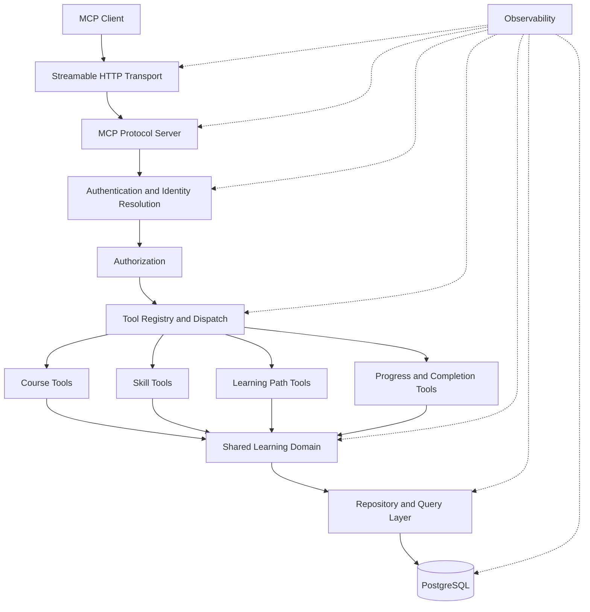
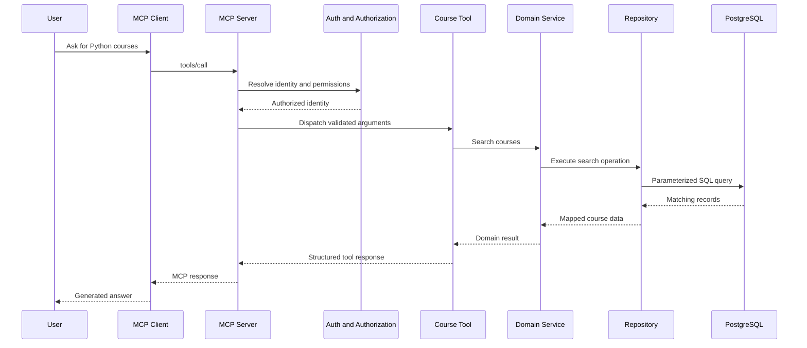
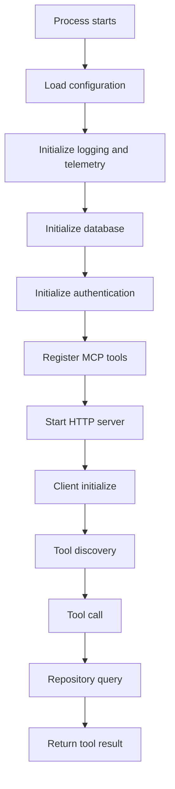

> **Series:** Building Enterprise AI Integrations with Model Context Protocol  
> **Part 1 --- Architecture and Engineering**  
> **Status:** Implementation and local validation completed for the described engineering work. Production behaviour, quantitative performance improvements, and deployment-specific operational metrics should be reported only where independently verified.

## Overview

Building an MCP server that exposes enterprise learning data to an AI agent is not simply a matter of registering a few tools and connecting them to a database.

The server sits between an AI client and an enterprise application. It must translate natural-language-driven tool requests into controlled application operations, identify the user making the request, enforce access boundaries, retrieve relevant data efficiently, and return predictable results that the agent can interpret.

The challenge becomes more significant when the same MCP server needs to work across different clients and enterprise environments. A local developer workflow, an IDE-based MCP client, and an enterprise agent platform may have different authentication and registration capabilities, even though they need access to the same underlying business capabilities.

This article documents the engineering approach behind a Learning Agent MCP server built with Go and PostgreSQL. It explores the architecture, tool boundaries, identity model, query execution, database performance, observability, testing, and operational considerations.

The central engineering objective was to create a server that is not only functional, but also **understandable, measurable, maintainable, and safe to operate**.

**At a glance**

- **Problem:** Expose enterprise learning capabilities to AI clients without coupling business logic to a particular agent platform.
- **Approach:** Build a modular Go MCP server with Streamable HTTP, controlled identity resolution, reusable domain logic, and PostgreSQL-backed data access.
- **Architecture:** Separate protocol handling, authentication, authorization, tool handlers, domain services, repositories, and observability.
- **Performance focus:** Investigate broad-search latency, database query execution, connection behaviour, and tool-level timing.
- **Observability focus:** Make initialization, tool execution, database operations, outcomes, and failures independently diagnosable.
- **Outcome:** A working implementation with a clearer separation of responsibilities and a performance issue addressed through database indexing.
- **Status:** Engineering implementation completed and locally validated; production metrics and quantitative impact are not claimed here.

## 1. The problem is bigger than exposing database queries

An AI agent may ask questions such as:

- Which Python courses are available?
- Show me courses related to Python on Udemy.
- What learning paths are available to me?
- How many learning hours have I completed?
- Which skills am I currently developing?
- Show my learning progress and completion status.

At first glance, these requests appear to be straightforward database lookups.

However, a production-quality integration must solve several separate problems:

1. Understand which business capability the request maps to.
2. Resolve the authenticated user associated with the request.
3. Determine whether that user is allowed to access the requested information.
4. Validate and normalize the tool arguments.
5. Execute the correct query without exposing unrestricted database access.
6. Handle broad searches and potentially expensive filters.
7. Return a consistent response that the agent can interpret.
8. Make the execution observable when something fails or becomes slow.

A tool returning the correct response in one scenario does not establish that the overall integration is reliable.

Consider two requests:

> Show me Python courses on Udemy.

> Show me Python courses.

The first request contains a provider constraint. The second is broader and may match courses across multiple providers, categories, descriptions, or learning metadata.

A query that performs well for the first request may behave very differently for the second. If the second request times out, the problem may be in query construction, database execution, indexing, result volume, connection contention, or timeout handling.

Without visibility into those stages, the engineering team sees only the final symptom: the tool timed out.

The first architectural principle is therefore:

**An MCP integration needs observability across the entire execution path, not just successful tool responses.**

## 2. Context and constraints

The Learning Agent MCP server was designed to expose learning-related capabilities from an existing enterprise learning platform.

The server uses Go for its application and protocol layer and PostgreSQL as its data source. It exposes tools through Streamable HTTP so that compatible MCP clients can communicate with it over HTTP.

### The business capabilities

The initial capability area includes learning information such as:

- Courses and course discovery.
- Skills and skill-related information.
- Learning paths.
- Learning progress.
- Course completion.
- Learning hours invested.

These are application capabilities, not unrestricted database operations. Each tool should represent a meaningful business operation with a defined input and output contract.

### Enterprise environment

The learning database is deployed within the enterprise CAE/OpenShift environment. Local development and investigation use the available production database with read-only access; a separate test database was not available in the initial setup.

This creates an important engineering constraint: database investigation must not depend on modifying production data or running unsafe operations.

Any examples involving schema changes, data updates, migrations, or index creation in this article should be treated as design or implementation examples unless explicitly identified as completed work.

### Client independence

The server is intended to work with different MCP clients.

The existing MyPerformance MCP integration provides an enterprise reference for the way an MCP service can be registered and used through Circuit. However, client capabilities are not interchangeable.

For example:

- Circuit uses a static client registration model in the integration context described here.
- VS Code and Cursor can support Dynamic Client Registration, depending on their configuration and authentication setup.
- Local development can use a trusted identity header to simplify testing.

The server should not assume that every client uses the same OAuth flow or provides the same identity information.

### Authentication and authorization

Two questions must remain separate:

- **Authentication:** Who is making this request?
- **Authorization:** What is this user allowed to access?

A valid token or trusted identity header is not, by itself, proof that a user is authorized to retrieve every learning record.

The server needs a clear identity resolution boundary and an explicit access-control decision before returning user-specific data.

### Constraints at a glance

| Area | Constraint or design consideration |
|---|---|
| Runtime | Go |
| Database | PostgreSQL |
| Protocol | MCP over Streamable HTTP |
| Deployment environment | Enterprise CAE/OpenShift |
| Database access during local investigation | Read-only access to the available production database |
| Local identity | Trusted CEC identity header for controlled development |
| Enterprise identity | Token/JWKS-based identity validation where configured |
| Client support | Different MCP clients may have different OAuth and registration capabilities |
| Data access | Approved application-level, read-only learning operations |
| Operations | Initialization, query execution, failures, and latency must be observable |

## 3. Requirements and success criteria

The implementation needed to satisfy more than protocol compatibility.

### Functional requirements

1. Expose learning capabilities through well-defined MCP tools.
2. Validate tool arguments before querying the database.
3. Resolve the user associated with the request.
4. Enforce access rules before retrieving user-specific data.
5. Support meaningful search filters without requiring users to specify every optional field.
6. Return structured, predictable responses.
7. Handle empty results and invalid inputs without treating them as infrastructure failures.

### Architectural requirements

1. Keep the MCP protocol layer separate from business logic.
2. Keep authentication and authorization separate from tool-specific query logic.
3. Give each tool a clear responsibility.
4. Reuse shared domain logic where multiple tools need the same behaviour.
5. Avoid duplicating SQL or business rules merely to make module boundaries appear independent.
6. Keep database access behind repository or query-layer boundaries.
7. Make configuration environment-driven so local and deployed environments can use different settings.

### Operational requirements

1. Measure tool execution time independently for each tool.
2. Measure database operation latency.
3. Record success, empty-result, validation-error, authorization-error, timeout, and database-error outcomes distinctly.
4. Capture enough context to investigate slow requests.
5. Measure startup and initialization behaviour separately from individual tool calls.
6. Preserve cancellation and deadline propagation.
7. Avoid high-cardinality telemetry labels that create unnecessary monitoring cost.

### Success criteria

The implementation should make it possible to answer questions such as:

- Which tool is slow?
- Is the delay in the tool handler, service layer, or database?
- Is the database connection pool saturated?
- Does a broad search produce a significantly different query plan?
- Did a request return no results, fail validation, or time out?
- Did initialization fail before the server began accepting tool calls?
- Can a developer reproduce the same failure locally?

A successful integration is one where these questions can be investigated using evidence rather than guesswork.

## 4. Design and architecture

### Design summary

The architecture separates the responsibilities of the MCP server into layers.



The diagram represents logical responsibilities. It does not require every layer to be deployed as a separate service or process.

The important property is that protocol concerns, identity decisions, business operations, and database access remain independently understandable.

### Component responsibilities

**1. MCP transport and protocol layer**

This layer handles communication with the MCP client.

Its responsibilities include:

- Accepting Streamable HTTP requests.
- Handling MCP protocol operations.
- Managing tool registration and discovery.
- Dispatching tool calls.
- Returning protocol-compatible responses.

It should not contain learning-specific SQL or business rules.

**2. Authentication and identity resolution**

This layer determines the identity associated with the incoming request.

It may use different authentication providers depending on the environment:

- A trusted CEC header in controlled local development.
- Validated enterprise tokens in an enterprise deployment.
- A configured identity provider or middleware integration where required.

The identity provider should be replaceable without changing every tool handler.

**3. Authorization**

Authentication establishes identity; authorization decides whether the identity can access the requested capability.

For example, a user requesting personal learning progress should not be able to retrieve another employee's progress simply by changing a tool argument.

Authorization should be enforced on the server side. It should not rely on the AI model to behave correctly.

**4. Tool modules**

Tool modules expose the business capabilities through explicit contracts.

A tool should define:

- Its name and description.
- Its input schema.
- Argument validation.
- The operation it performs.
- The response shape.
- Its error behaviour.

A tool handler should remain thin. It should coordinate the request rather than own every business and database decision.

**5. Shared learning domain**

The shared domain layer contains reusable learning-related logic.

For example, course normalization, common access rules, or shared data interpretation may be used by more than one tool.

Sharing should happen when the behaviour is genuinely common. It should not become a generic abstraction that hides tool-specific requirements.

**6. Repository and query layer**

The repository layer owns database interaction.

Its responsibilities include:

- Building and executing SQL queries.
- Binding parameters safely.
- Applying appropriate filters.
- Respecting context cancellation and deadlines.
- Mapping database rows into application types.
- Returning errors with enough context for diagnosis.

The repository should not determine which MCP tool is being called unless that information is explicitly passed for instrumentation.

**7. Observability**

Observability spans the complete request lifecycle.

It should capture protocol, identity, tool execution, domain, repository, and database behaviour without leaking sensitive user or learning data.

### Data flow: from a natural-language request to a database response

Consider the request:

> Show me Python courses.



This sequence is deliberately more detailed than a simple tool-to-database diagram.

Each transition is a possible failure or latency boundary. If the request takes too long, the engineering team should be able to identify which stage contributed to the delay.

## 5. Key engineering decisions

### Decision 1: Keep protocol handling separate from business logic

The MCP server should not become a collection of protocol callbacks containing SQL statements.

A cleaner structure is:

```text
Request
  |
  v
MCP Handler
  |
  v
Tool Handler
  |
  v
Domain Service
  |
  v
Repository
  |
  v
PostgreSQL
```

This makes it possible to test business operations without requiring an MCP client for every test.

It also makes the application easier to evolve if another transport or integration boundary is introduced later.

### Decision 2: Use modular authentication providers

A local development identity mechanism should not become the production authentication architecture.

The identity provider should be configurable:

```go
type Identity struct {
    UserID string
    Source string
}

type IdentityProvider interface {
    Resolve(ctx context.Context) (Identity, error)
}
```

Illustrative implementations might include:

```go
type LocalHeaderIdentityProvider struct {
    HeaderName string
}

type OIDCIdentityProvider struct {
    JWKSURI string
    Issuer  string
    Audience string
}
```

The local provider can resolve a trusted CEC identity header in a controlled environment.

The enterprise provider can validate a signed token using the configured issuer, audience, and signing keys.

The important distinction is that the header is trusted only because the local environment explicitly establishes that trust. A public or untrusted HTTP client must not be allowed to choose an arbitrary identity header and impersonate another user.

### Decision 3: Keep authentication and authorization independent

A valid identity does not automatically grant access to every operation.

A useful conceptual flow is:

```text
Incoming request
    |
    v
Authenticate identity
    |
    v
Resolve active user
    |
    v
Check access level and permissions
    |
    v
Execute authorized tool operation
```

The server should validate the identity and its status before using it to scope database queries.

Where the application has user-level access rules, those rules should be enforced in the service or authorization boundary rather than delegated to the model.

### Decision 4: Use tool-oriented modules without duplicating shared logic

Modularity is useful when it makes ownership clear.

A possible layout is:

```text
internal/
├── app/
│   ├── bootstrap.go
│   └── config.go
│
├── transport/
│   └── mcp/
│       ├── server.go
│       └── registry.go
│
├── auth/
│   ├── provider.go
│   ├── local/
│   └── oidc/
│
├── authorization/
│   └── service.go
│
├── tools/
│   ├── courses/
│   │   ├── handler.go
│   │   ├── schema.go
│   │   └── query.go
│   ├── skills/
│   ├── learning_paths/
│   └── progress/
│
├── learning/
│   ├── models.go
│   ├── service.go
│   └── rules.go
│
├── repository/
│   ├── postgres/
│   └── interfaces.go
│
└── observability/
    ├── logging.go
    ├── metrics.go
    └── tracing.go
```

This is an illustrative organization, not a claim that every directory or filename exactly matches the deployed repository.

The ownership principle is more important than the folder names:

- Tool-specific filters belong with the tool that owns the operation.
- Shared learning rules belong in the domain layer.
- SQL execution belongs in the repository boundary.
- Protocol registration belongs in the MCP transport layer.
- Identity resolution belongs in authentication.
- Access decisions belong in authorization.

Avoid creating duplicate query implementations just to make each tool appear independent.

### Decision 5: Treat observability as part of the execution design

Observability should not be added only after a timeout occurs.

Every major execution boundary should expose enough information to distinguish normal work from unexpected behaviour.

A tool-level duration alone is insufficient. It tells us that a request was slow, but not why.

The server needs a layered view:

1. Request and protocol lifecycle.
2. Identity resolution and authorization.
3. Tool handler execution.
4. Domain service execution.
5. Repository operation.
6. Database execution and connection behaviour.

### Decision 6: Optimize based on query evidence

Broad searches can behave very differently from filtered searches.

The correct response to a timeout is not immediately to increase the timeout value.

The investigation should first establish:

- Which SQL statement is being executed?
- Which predicates are applied?
- Are the predicates selective?
- Does PostgreSQL use an appropriate execution plan?
- Are required indexes available?
- Is the query sorting or joining a large result set?
- Is the connection pool waiting for an available connection?
- Is the application retrieving more records than it needs?

In this project, the broad Python course search was investigated and the issue was resolved by adding database indexes.

The exact index definitions and quantitative before-and-after measurements are not included here because they have not been independently documented for this article.

## 6. Implementation

This section explains the main implementation patterns and engineering boundaries. Code examples are illustrative and should be adapted to the actual repository interfaces and telemetry conventions.

### 6.1 Application bootstrap and dependency construction

The bootstrap layer should construct shared dependencies once and pass them to the relevant components.

```go
type Dependencies struct {
    DB          *sql.DB
    Identity    IdentityProvider
    Authorizer  Authorizer
    Logger      *slog.Logger
    Metrics     Metrics
    Tracer      Tracer
}

func BuildServer(
    ctx context.Context,
    cfg Config,
) (*Server, error) {
    db, err := OpenDatabase(ctx, cfg.Database)
    if err != nil {
        return nil, fmt.Errorf("open database: %w", err)
    }

    identityProvider, err := BuildIdentityProvider(cfg.Auth)
    if err != nil {
        return nil, fmt.Errorf("build identity provider: %w", err)
    }

    deps := Dependencies{
        DB:         db,
        Identity:   identityProvider,
        Authorizer: NewAuthorizer(),
        Logger:     NewLogger(cfg.Logging),
        Metrics:    NewMetrics(),
        Tracer:     NewTracer(),
    }

    return RegisterTools(deps)
}
```

The example demonstrates the dependency-construction boundary.

The bootstrap layer should own resource creation and lifecycle management. Individual tool handlers should receive only the dependencies they actually need.

This reduces hidden global state and makes unit testing more predictable.

### 6.2 Tool registration and contracts

A tool is an application capability exposed through the MCP protocol.

A course search tool might accept:

```json
{
  "query": "python",
  "provider": "Udemy"
}
```

The provider is an optional filter. Its absence should not automatically make the request invalid.

The server should distinguish between:

- A required argument that is missing.
- An optional argument that is not supplied.
- An empty search that is valid.
- An invalid argument that cannot be safely interpreted.

This distinction is important for natural-language interfaces because users do not always specify every possible filter.

### 6.3 Thin tool handlers

A handler should validate input, obtain the identity context, call the relevant service, and translate the result into the expected MCP response.

Illustrative Go:

```go
type SearchCoursesHandler struct {
    service CourseService
}

func (h *SearchCoursesHandler) Handle(
    ctx context.Context,
    input SearchCoursesInput,
) (SearchCoursesOutput, error) {
    if err := input.Validate(); err != nil {
        return SearchCoursesOutput{},
            fmt.Errorf("validate course search: %w", err)
    }

    result, err := h.service.Search(ctx, input)
    if err != nil {
        return SearchCoursesOutput{},
            fmt.Errorf("search courses: %w", err)
    }

    return result, nil
}
```

The handler does not need to know how PostgreSQL executes the search.

That separation allows query behaviour to be improved without changing the MCP contract.

### 6.4 Query composition and optional filters

A search tool should support its intended range of valid inputs.

For example:

```text
Search courses
    |
    +-- Query: python
    |
    +-- Provider: optional
    |
    +-- Category: optional
    |
    +-- Pagination: bounded
```

The query layer should build a safe, parameterized query based on the supplied filters.

Illustrative SQL:

```sql
SELECT
    id,
    title,
    provider,
    description
FROM courses
WHERE
    LOWER(title) LIKE LOWER($1)
ORDER BY title
LIMIT $2;
```

A provider-specific filter can be added when supplied:

```sql
AND provider = $3
```

The actual SQL should reflect the real schema, data distribution, search requirements, and indexes.

The important design principle is that an optional filter should not accidentally become a mandatory condition or produce a different, inefficient query path.

### 6.5 Database performance investigation

A useful investigation begins with the actual query and its execution plan.

For PostgreSQL, `EXPLAIN` and `EXPLAIN ANALYZE` provide evidence about how the database executes a statement.

For example:

```sql
EXPLAIN (ANALYZE, BUFFERS)
SELECT
    id,
    title,
    provider
FROM courses
WHERE
    LOWER(title) LIKE '%python%'
ORDER BY title;
```

This can help investigate:

- Sequential scans.
- Index scans.
- Rows scanned versus rows returned.
- Join behaviour.
- Sort operations.
- Buffer activity.
- Actual execution time.

`EXPLAIN ANALYZE` executes the statement. It should be used with care, especially for expensive queries and any statement that could modify data.

An index should be introduced based on the predicate and execution plan, not simply because a query is slow.

For example, a conventional B-tree index may help equality or prefix-based searches, while substring matching can require a different indexing strategy. The appropriate choice depends on the actual query operators and PostgreSQL configuration.

In this implementation, database indexing addressed the broad Python search timeout. The key lesson was that a query that works with one selective filter may still need a different access path when the search becomes broader.

### 6.6 Context propagation and cancellation

Go's `context.Context` should travel through the complete request path.

```go
func (r *CourseRepository) Search(
    ctx context.Context,
    query string,
) ([]Course, error) {
    rows, err := r.db.QueryContext(
        ctx,
        `
        SELECT id, title, provider
        FROM courses
        WHERE title ILIKE $1
        `,
        "%"+query+"%",
    )
    if err != nil {
        return nil, fmt.Errorf("execute course query: %w", err)
    }

    defer rows.Close()

    var courses []Course

    for rows.Next() {
        var course Course

        if err := rows.Scan(
            &course.ID,
            &course.Title,
            &course.Provider,
        ); err != nil {
            return nil, fmt.Errorf("scan course: %w", err)
        }

        courses = append(courses, course)
    }

    if err := rows.Err(); err != nil {
        return nil, fmt.Errorf("iterate course rows: %w", err)
    }

    return courses, nil
}
```

This example shows context-aware database access and explicit row-error handling.

The actual query should use the repository's established search strategy and bounded result policy.

Cancellation matters because a client may stop waiting for a response, a request deadline may expire, or an upstream operation may be cancelled.

A cancellation signal that stops at the handler but does not reach the database can leave expensive work running unnecessarily.

### 6.7 Tool-level latency instrumentation

Each tool call should have an execution boundary that records its duration and outcome.

Conceptually:

```go
func InstrumentTool(
    ctx context.Context,
    toolName string,
    metrics Metrics,
    logger *slog.Logger,
    next func(context.Context) error,
) error {
    start := time.Now()

    err := next(ctx)
    duration := time.Since(start)

    outcome := "success"

    if err != nil {
        outcome = ClassifyError(err)
    }

    metrics.ObserveToolDuration(
        toolName,
        outcome,
        duration,
    )

    logger.InfoContext(
        ctx,
        "tool execution completed",
        "tool", toolName,
        "outcome", outcome,
        "duration_ms", duration.Milliseconds(),
    )

    return err
}
```

This is a conceptual example. The actual metrics API and error taxonomy should match the implementation.

The instrumentation should distinguish different outcomes rather than collapsing every unsuccessful request into a generic error.

Possible outcomes include:

- Success.
- Empty result.
- Validation failure.
- Authentication failure.
- Authorization failure.
- Database error.
- Timeout.
- Cancellation.
- Internal error.

An empty result is not necessarily a failure. It may be a valid business outcome.

### 6.8 Repository-level database timing

Tool timing answers:

> How long did the complete tool operation take?

Repository timing answers:

> How long did the database operation take?

These are different measurements.

For example:

```go
func (r *CourseRepository) Search(
    ctx context.Context,
    query string,
) ([]Course, error) {
    start := time.Now()

    rows, err := r.db.QueryContext(
        ctx,
        courseSearchSQL,
        query,
    )

    duration := time.Since(start)

    r.metrics.ObserveDBOperation(
        "course_search",
        duration,
        err,
    )

    if err != nil {
        return nil, fmt.Errorf("course search query: %w", err)
    }

    defer rows.Close()

    // Scan and map rows.
    return scanCourses(rows)
}
```

This example measures the query call, but it does not necessarily represent the full time spent consuming and mapping all returned rows.

For accurate end-to-end repository timing, the instrumentation boundary should include the relevant row iteration and mapping work. If the objective is to isolate database execution from application-side processing, those timings should be recorded separately.

That distinction prevents a slow response-mapping operation from being incorrectly attributed to PostgreSQL.

### 6.9 Connection pool visibility

Database latency can be affected by connection acquisition and pool contention, not only by SQL execution.

Go's `database/sql` exposes connection pool statistics through `DB.Stats()`.

```go
stats := db.Stats()

logger.Info(
    "database pool statistics",
    "open_connections", stats.OpenConnections,
    "in_use", stats.InUse,
    "idle", stats.Idle,
    "wait_count", stats.WaitCount,
    "wait_duration", stats.WaitDuration,
    "max_open_connections", stats.MaxOpenConnections,
)
```

These values help investigate:

- Whether connections are frequently in use.
- Whether requests are waiting for connections.
- Whether the configured maximum is restrictive.
- Whether connection usage changes during traffic spikes.

Pool statistics are process-level observations. They should be sampled and interpreted over time rather than treated as proof of a problem from one snapshot.

### 6.10 Initialization and request lifecycle visibility

Not all latency occurs during a tool call.

An MCP integration has multiple lifecycle operations:

- Application process startup.
- Configuration loading.
- Database connection establishment.
- Database readiness checks.
- Identity provider initialization.
- MCP server setup.
- Client initialization.
- Tool discovery through `tools/list`.
- Individual execution through `tools/call`.

These operations should not be grouped into one generic startup or request duration.

A useful lifecycle model is:



This makes it possible to distinguish an application startup problem from a database query problem.

It also avoids attributing client-side reasoning time to the MCP server. The agent's reasoning and final answer generation occur outside the server's own execution unless the client runtime explicitly propagates and records those timings.

### 6.11 Trace hierarchy

Distributed tracing can represent the relationships between operations.

An illustrative trace structure:

```text
mcp.tools.call
    |
    +-- identity.resolve
    |
    +-- authorization.check
    |
    +-- tool.courses.search
          |
          +-- learning.course_search
                |
                +-- db.query
                |
                +-- db.rows.map
```

The purpose is not to create a span for every trivial function.

The goal is to instrument meaningful boundaries so that a slow trace can explain where time was spent.

Where possible, request context and trace identifiers should propagate through the application and into database operations.

### 6.12 Metrics, logs, and traces have different jobs

These three observability signals complement one another.

| Signal | Main question | Example |
|---|---|---|
| Metrics | Is the system healthy over time? | Tool latency distribution |
| Logs | What happened in this request? | Search timed out |
| Traces | Where was time spent? | Database query consumed most of the request duration |

A practical metrics design may include:

- Tool call count.
- Tool execution duration.
- Tool outcome count.
- Database operation duration.
- Database operation error count.
- Connection pool statistics.
- Initialization duration.
- Request timeout count.

A practical structured log may include:

```json
{
  "event": "tool_execution_completed",
  "tool": "search_courses",
  "outcome": "success",
  "duration_ms": 142,
  "trace_id": "example-trace-id"
}
```

This JSON is illustrative, not a claim about the exact production log schema.

Avoid putting raw search text, employee identifiers, course descriptions, tokens, or other sensitive values into metric labels.

Tool names and bounded outcome categories are usually more appropriate dimensions than user-specific or query-specific labels.

## 7. Failure modes and edge cases

A reliable MCP server needs predictable behaviour when dependencies fail or inputs are incomplete.

| Scenario | Possible cause | Engineering response |
|---|---|---|
| Broad search timeout | Expensive query plan or insufficient indexing | Inspect SQL, execution plan, and database timings |
| Provider-specific search works but broad search fails | Optional filters produce different query paths | Test each supported filter combination |
| No courses found | Valid search with no matching records | Return a valid empty result |
| Invalid tool arguments | Missing or malformed required input | Validate before database access |
| Unknown identity | Missing or invalid authentication context | Reject the request |
| Inactive user | Identity exists but account is not active | Enforce account-status rules |
| Unauthorized access | User requests data outside their permissions | Deny access before returning records |
| Database unavailable | Connection or infrastructure failure | Return a controlled error and record the failure |
| Connection pool contention | Too many concurrent operations or restrictive pool settings | Inspect pool statistics and request concurrency |
| Client cancellation | Client stops waiting | Propagate context cancellation |
| Large result set | Broad search returns too many records | Apply pagination and bounded response sizes |
| Row mapping failure | Schema mismatch or unexpected database values | Record a controlled internal error |
| Telemetry backend unavailable | Monitoring infrastructure failure | Avoid making normal business operations dependent on telemetry availability |
| Initialization failure | Invalid configuration or unavailable dependency | Fail clearly and expose the failing initialization stage |

### Search behaviour deserves special attention

Search tools are especially sensitive to vague or broad inputs.

A natural-language query may contain:

- A keyword.
- A provider.
- A category.
- A skill.
- A course title.
- Several combined constraints.
- No explicit filters beyond the search phrase.

The tool contract should define what happens when each optional constraint is missing.

It should also define:

- Maximum result count.
- Default ordering.
- Pagination behaviour.
- Minimum or maximum query length, where appropriate.
- Empty-query behaviour.
- Whether substring matching is supported.
- How unsupported filters are handled.

These decisions should be explicit rather than left to accidental SQL behaviour.

### Avoid treating every timeout as a database problem

A timeout can originate from several different stages:

```text
Client deadline
    |
    v
MCP request handling
    |
    v
Authentication
    |
    v
Tool execution
    |
    v
Connection acquisition
    |
    v
SQL execution
    |
    v
Row mapping
    |
    v
Response serialization
```

If the system records only one total duration, the actual cause remains hidden.

This is why tool-level and database-level instrumentation must be interpreted together.

## 8. Testing and validation

Testing should cover both application correctness and the operational properties of the server.

### Unit testing

Test individual responsibilities independently:

- Input validation.
- Identity resolution.
- Authorization decisions.
- Tool handler behaviour.
- Domain service logic.
- Error classification.
- Response mapping.

Mocking repository interfaces allows business behaviour to be tested without depending on PostgreSQL.

### Repository and database testing

Repository tests should validate:

- Parameter binding.
- Optional filters.
- Empty results.
- Sorting and pagination.
- Row mapping.
- Database error handling.
- Context cancellation.
- Query behaviour for broad and restrictive searches.

The broad-search scenario should be a regression case because it previously exposed a performance problem.

### MCP protocol testing

The MCP layer should be tested for:

- Server initialization.
- Tool discovery.
- Tool input schema behaviour.
- Valid tool invocation.
- Invalid arguments.
- Error responses.
- Client disconnection and cancellation.

MCP Inspector can be used to inspect the server's exposed tools and exercise tool calls during development.

It is particularly useful for validating the protocol contract independently of the AI agent's interpretation of the tool descriptions.

### Authentication and authorization testing

Test the difference between identity and permission:

| Test | Expected behaviour |
|---|---|
| Valid local trusted identity | Resolve the configured local user |
| Missing local identity header | Reject the request |
| Invalid enterprise token | Reject authentication |
| Invalid token signature | Reject authentication |
| Unexpected issuer or audience | Reject authentication |
| Inactive user | Deny access according to policy |
| User requests another user's data | Enforce the authorization boundary |
| Valid identity with insufficient permission | Deny the operation |

The local header provider should be enabled only in an environment where the header is supplied by a trusted mechanism.

### Observability validation

Observability needs its own tests.

A useful validation exercise is to execute one successful request and one failing request, then verify that the signals explain the difference.

For example:

1. Invoke a course search.
2. Confirm that a tool-level duration is recorded.
3. Confirm that the repository operation is observable.
4. Confirm that the outcome is classified correctly.
5. Trigger a controlled validation failure.
6. Confirm that it is not counted as a database failure.
7. Trigger a controlled timeout.
8. Confirm that timeout and cancellation information is retained.
9. Inspect the trace or correlated logs.
10. Verify that sensitive values are not exposed.

A dashboard that displays a latency number without enough context to investigate it is only a partial observability solution.

### Performance validation

A meaningful performance investigation should compare equivalent workloads.

For a course search, useful test cases include:

- Search with a provider filter.
- Search without a provider filter.
- Search with a restrictive keyword.
- Search with a broad keyword.
- Search with no matching results.
- Search returning a larger result set.

The comparison should capture query behaviour, execution plans, result counts, and timing.

The test should also distinguish warm-cache behaviour from cold-cache behaviour where that distinction matters.

Do not compare two runs with different filters or result sizes and attribute every timing difference to an index change.

## 9. Results

The completed engineering work addressed the main architectural and operational concerns identified during implementation.

### What was implemented and validated

- A Go-based Learning Agent MCP server.
- MCP communication through Streamable HTTP.
- Learning-related tool capabilities.
- A modular approach to tool and application responsibilities.
- A separation between identity resolution and authorization.
- A database access boundary for PostgreSQL-backed operations.
- Observability work covering tool execution and database behaviour.
- A clearer approach to investigating initialization and request lifecycle latency.
- Local validation of the implemented work.

### Performance investigation

A specific issue appeared when searching for Python courses without a provider constraint.

The provider-constrained request worked, while the broader request timed out.

The investigation identified database indexing as the area requiring correction, and the issue was resolved by adding indexes.

This is an important example of why search performance should be evaluated against realistic input combinations. A query that works with one selective filter does not prove that the broader query path is efficient.

### What is not quantified here

This article does not claim:

- A specific percentage reduction in query latency.
- A particular number of milliseconds saved.
- A production throughput figure.
- A measured database CPU reduction.
- A measured improvement in connection pool utilisation.
- A specific index type or complete index definition.
- A production availability or reliability percentage.

Those claims would require verified telemetry exports, query plans, benchmark results, or production monitoring evidence.

The meaningful result is that the architecture and instrumentation make the system easier to understand, and the identified broad-search issue was addressed through database indexing.

## 10. Lessons learned

### 1. A working tool is not the same as a reliable integration

A successful tool response proves that one request path worked.

It does not prove that authentication, authorization, query performance, cancellation, initialization, and error handling are reliable under different conditions.

### 2. Natural-language tools need carefully designed input contracts

Users should not need to know every database filter.

Optional filters must be genuinely optional, and the server must define how broad or incomplete requests are handled.

### 3. Broad queries must be treated as first-class workloads

Restrictive filters can hide inefficient query behaviour.

Performance validation should include the broadest valid inputs the product intends to support.

### 4. Identity resolution must be independent of the client

Different MCP clients may have different registration and authentication capabilities.

Keeping identity providers modular avoids embedding client-specific assumptions throughout the business layer.

### 5. Authentication is not authorization

Knowing who made the request is only the beginning.

The server must also determine whether that user is permitted to retrieve the requested information.

### 6. Observability should follow the architecture

If the application is layered, the measurements should help distinguish those layers.

Tool duration, repository duration, connection pool behaviour, and initialization time answer different questions.

### 7. A timeout is a symptom, not a diagnosis

Increasing the timeout may hide the problem without resolving it.

The correct approach is to identify the slow execution boundary and investigate its underlying cause.

### 8. Modularity should improve ownership, not increase duplication

A clean module structure is valuable only when it makes responsibilities easier to understand and change.

Shared domain behaviour should remain shared where that is the correct design.

### 9. Operational correctness is part of product correctness

An enterprise agent integration must be secure, diagnosable, and maintainable.

These properties are not optional enhancements to a tool that already works. They are part of what makes the integration suitable for enterprise use.

## 11. Future improvements

The completed implementation provides a foundation for further production-readiness work.

The following are potential next steps, not claims that every item is already implemented.

### 1. Establish a standard telemetry contract

Define consistent names and attributes for:

- MCP lifecycle operations.
- Tool calls.
- Tool outcomes.
- Repository operations.
- Database errors.
- Timeouts and cancellations.
- Initialization stages.

This makes telemetry easier to query across tools and environments.

### 2. Introduce service-level performance objectives

Once representative production measurements are available, define targets for:

- Tool latency.
- Error rate.
- Timeout rate.
- Database operation latency.
- Initialization success.
- Availability.

Targets should be based on actual usage and business expectations, not arbitrary numbers.

### 3. Build tool-level performance dashboards

A useful dashboard should allow an engineer to filter by tool and outcome and inspect:

- Request volume.
- Latency distributions.
- Error counts.
- Timeout counts.
- Database operation duration.
- Connection pool behaviour.

Avoid relying only on average latency. Percentiles such as p50, p95, and p99 can reveal slow requests that averages hide.

### 4. Add query regression coverage

The broad Python course search should remain part of the performance regression suite.

As the learning dataset grows, query plans and execution times should be reviewed under representative workloads.

### 5. Strengthen authorization coverage

Identity and access rules should be tested against realistic enterprise scenarios, including inactive users, insufficient access levels, and attempts to request data outside the user's permitted scope.

### 6. Standardize client integration configuration

Document the differences between Circuit, VS Code, Cursor, and local development.

The server should expose a consistent capability contract while allowing the authentication and client-registration setup to vary by environment.

### 7. Improve operational diagnostics

Provide clear startup diagnostics, readiness checks, dependency status, and structured failure information.

A server that cannot initialize should explain which dependency or configuration stage failed without exposing secrets.

### 8. Review resource limits and concurrency

As usage increases, validate:

- Database connection pool configuration.
- Request concurrency.
- Query deadlines.
- Maximum result sizes.
- HTTP server timeouts.
- Memory usage under larger responses.

The correct limits should be established through workload testing and operational evidence.

## 12. What comes next?

The next stage is to move from a working MCP integration to a repeatable operational model.

Potential follow-up engineering work includes:

- Formalizing the authentication provider contract.
- Documenting the client-specific registration and identity flows.
- Establishing standard metrics, logs, and trace conventions.
- Creating tool-level performance dashboards.
- Building a repeatable query-performance regression suite.
- Validating behaviour under realistic concurrency and failure conditions.
- Documenting deployment, configuration, and operational runbooks.

The goal is not to add complexity for its own sake. It is to make every important behaviour explainable and every operational issue diagnosable.

## Conclusion

An enterprise MCP server is more than a protocol adapter between an AI agent and a database.

It is an application boundary responsible for translating agent requests into controlled business operations. That boundary must preserve identity, enforce authorization, execute efficient queries, handle failures predictably, and provide enough operational evidence to explain its behaviour.

The Learning Agent MCP work demonstrates why these concerns need to be designed together.

A modular Go architecture provides clear ownership across transport, identity, tools, domain logic, and data access. PostgreSQL performance investigation addresses the difference between restrictive and broad search workloads. Tool-level and database-level observability make it possible to investigate latency rather than merely report that a request was slow.

The broader engineering lesson is straightforward:

**A production-oriented AI integration should not only return the right answer. It should make the path to that answer secure, efficient, measurable, and maintainable.**

---

## Related articles

- **Architecture and implementation:** *Engineering an Observable Learning Agent MCP Server* --- current article.
- **Authentication and identity:** *Designing Client-Independent Authentication for Enterprise MCP Servers* --- potential follow-up.
- **Performance engineering:** *Diagnosing and Optimizing PostgreSQL Search Workloads Behind MCP Tools* --- potential follow-up.
- **Operational readiness:** *From MCP Tool Execution to Production Observability* --- potential follow-up.

---

*Disclosure and accuracy note: This article describes the engineering approach and implementation context of a Learning Agent MCP server built with Go and PostgreSQL. Code snippets, SQL statements, directory structures, telemetry examples, and diagrams are illustrative and may not exactly match the final repository. The broad-search timeout and its resolution through database indexing are based on the reported implementation experience. No unsupported production latency figures, benchmark results, index definitions, availability metrics, or quantitative performance improvements are claimed. Client authentication capabilities vary by client and configuration. Any public version should be reviewed to remove confidential enterprise architecture, internal identifiers, infrastructure details, and proprietary information before publication.*
